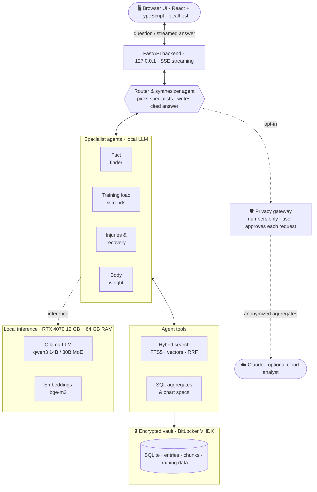
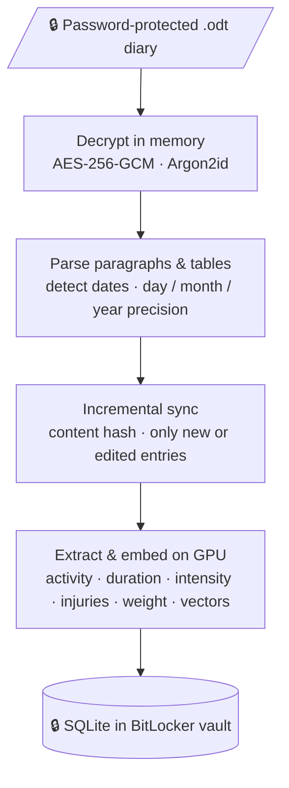

# document-analyzer

**Ask questions about your personal training diary with AI agents running entirely on your own PC.**

A training diary kept over many years holds answers that are hard to find by scrolling:
*When did I run my first half marathon? How has my weekly training volume developed? How long did my knee injury keep me off the bike? Am I training harder or easier than five years ago, and how has my body weight followed?*

`document-analyzer` turns a password-protected `.odt` training diary (free text: what you did, how long, how hard) into a dated, searchable, enriched knowledge base and lets a team of local AI agents answer such questions **with citations and charts**, without sending a single sentence to the internet.

> **Status:** work in progress. Encrypted ingestion, incremental sync, body-weight statistics, local hybrid search with cited answers and a privacy-gateway proof of concept are working. See the [roadmap](#roadmap).

## Highlights
- **Local by design.** The LLM, embeddings, vector search and database all run on one desktop GPU. The backend binds to `127.0.0.1`.
- **Agentic architecture.** A router agent hands questions to specialist agents (facts, training load & trends, injuries & recovery, body weight). They use typed tools such as hybrid search and SQL aggregates, and every answer cites its source entries by date.
- **Made for messy real-world notes.** Mixed German/English, years of changing date formats (`12.03.2021`, `1.1.99`, `Dez 1989`, `1995:`), and periods written as tables are all handled.
- **Numbers stay numbers.** Values like body weight are extracted deterministically with your own patterns. Statistics come from SQL, never from the language model's memory.
- **Encrypted at rest.** The diary stays password-protected (decrypted in memory only), and all derived data lives in a BitLocker-encrypted virtual drive.
- **Daily-use friendly.** Incremental sync re-processes only new or edited entries; the search index follows automatically.
- **Optional cloud insight, under control.** A Claude analyst can design and interpret charts, but it only ever receives anonymized monthly aggregates through a privacy gateway, and you approve every request.

## How a question is answered


## How entries get in


## Making the most of one desktop GPU
| Component | Role |
|---|---|
| **RTX 4070 (12 GB VRAM)** | LLM inference via Ollama/CUDA, embeddings |
| **64 GB DDR5** | Holds the expert layers of a 30B mixture-of-experts model that don't fit in VRAM, so a model larger than the GPU still runs |
| **2 TB NVMe** | Model files, the encrypted vault, encrypted backups |

Model line-up (all local, swappable):
- **Interactive answers:** `qwen3:14b`, about 85% on the GPU. A cited answer takes about 20 seconds (~25 tokens/s).
- **Harder questions and batch work:** `qwen3:30b-a3b` (MoE). Only about 3B parameters are active per token, so it still runs with half its weights in system RAM; it's slower but more thorough.
- **Embeddings:** `bge-m3` (multilingual). About 8,000 chunks index in under three minutes.

Details: [docs/ARCHITECTURE.md](docs/ARCHITECTURE.md)

## Privacy & security
A training diary contains health data: injuries, illnesses, body weight. The design assumes the code is public and the attacker knows exactly how it works. Protection comes from keys, not from secrecy:
- No data in the repo, ever. A leak-guard git hook blocks data files and private terms.
- The diary is decrypted in memory only, and the password is never stored.
- Derived data is encrypted at rest (BitLocker XTS-AES-256) and locked when not in use.
- The local stack only talks to `127.0.0.1` and refuses cloud-hosted models. The only egress is the opt-in, schema-restricted privacy gateway.

Full threat model and hardening checklist: [docs/SECURITY.md](docs/SECURITY.md)

## Quick start (Windows 11)
```powershell
# 1. Encrypted vault for all derived data (admin PowerShell, once)
.\scripts\vault-create.ps1 -SizeGB 50

# 2. Backend
cd backend
python -m venv .venv
.venv\Scripts\python -m pip install -e ".[dev]"
.venv\Scripts\python -m pytest
cd ..

# 3. Leak-guard hooks
git config core.hooksPath scripts/hooks

# 4. Local models (once)
ollama pull bge-m3; ollama pull qwen3:14b; ollama pull qwen3:30b-a3b

# 5. Point the tools at your diary (stays on your PC, never in the repo)
[Environment]::SetEnvironmentVariable("DOC_PATH", "C:\path\to\training.odt", "User")

# 6. Sync (asks for the diary password; also updates the search index), then ask
.\scripts\vault-open.ps1
.\sync.ps1
.\ask.ps1 "Wann bin ich meinen ersten Halbmarathon gelaufen?"
.\ask.ps1 --first "Halbmarathon"
.\weight.ps1
.\scripts\vault-close.ps1
```
The sync prints a validation report with counts and positions only, no text. Wrong or missing dates can be fixed in `data\overrides.yaml` without touching the diary itself.

## Roadmap
| Phase | Scope | Status |
|---|---|---|
| 1 | Encrypted `.odt` ingestion, date detection, incremental sync, BitLocker vault, body-weight statistics | ✅ done |
| 2 | Chunking, local embeddings, hybrid search (FTS5 + sqlite-vec, RRF), local Q&A with date citations | ✅ done |
| 3 | Local LLM extraction per entry: activity, duration, intensity, injuries, training partners, milestones | ⏳ next |
| 4 | Router + specialist agents with typed tools and citations | ⏳ |
| 5 | React UI with streaming chat and interactive charts (training volume, intensity, weight) | ⏳ |
| 6 | Privacy gateway + optional cloud analyst (proof of concept: cloud-designed weight chart from monthly aggregates) | 🧪 PoC |

## Repository layout
```
backend/   Python: ingest/ (decrypt, parse, sync), search/ (index, hybrid search, Q&A),
           analysis/ (measurements, weight stats), privacy/ (gateway, cloud chart), tests/
config/    Example taxonomy and measurement patterns (copy to data/ and adapt)
docs/      Architecture and security documentation
samples/   Fully synthetic, fictional training diary (+ LibreOffice encryption helper)
scripts/   Vault scripts (PowerShell), leak-guard git hooks, publish script
data/      ← encrypted vault mount point, gitignored
```

## Tech stack
Python 3.11+ · odfpy · cryptography · argon2-cffi · SQLite (FTS5, sqlite-vec) · Ollama (qwen3, bge-m3) · pydantic · matplotlib · Anthropic SDK (optional) · BitLocker · upcoming: FastAPI, React + TypeScript + ECharts
